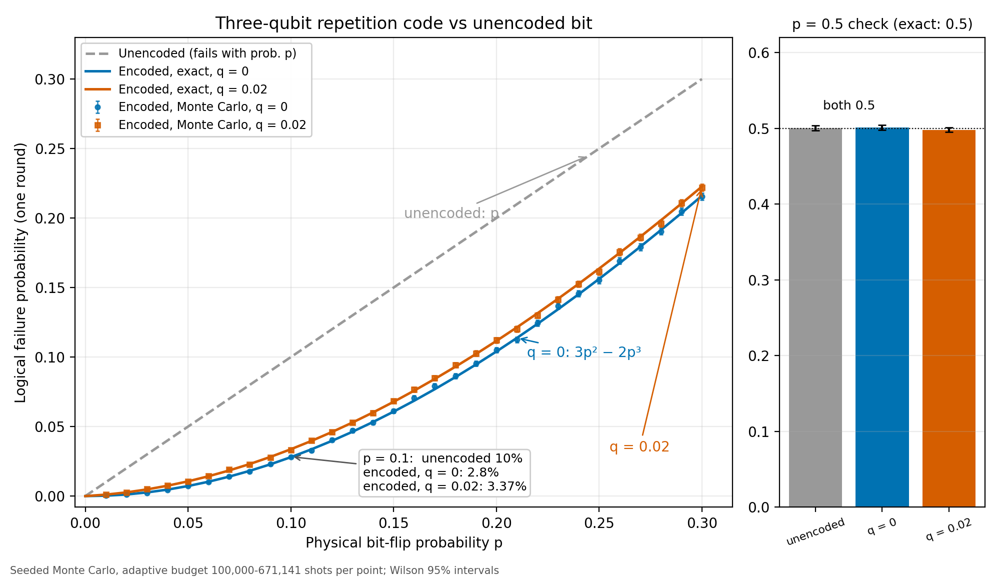

# Three-qubit bit-flip code: one correction round with noisy parity readout

**Research question.** How often does three-qubit repetition decoding fail
when each physical bit flips independently with probability *p* *and* each of
the two reported parity checks flips independently with probability *q*?

This project answers it with a seeded Monte Carlo experiment, an exact
32-event enumeration, automated tests, an executed notebook, a comparison
figure and two animations. Everything runs locally from a fresh environment.

## The model and decoder conventions

One error-correction round on three data qubits. Qubits are labelled 1-3.

- **Encoding.** Logical |0⟩ = 000, logical |1⟩ = 111. Only X (bit-flip)
  errors are modelled.
- **Noise.** Each data bit flips independently with probability p. Each of
  the two *reported* parity bits flips independently with probability q.
  Gates, state preparation and the final data readout are ideal.
- **Parity order (fixed).** s1 = q1⊕q2, then s2 = q2⊕q3.
- **Correction table (from the reported syndrome).**
  00 → do nothing; 10 → correct qubit 1; 11 → correct qubit 2; 01 → correct qubit 3.
- **Readout.** Ideal majority vote of the corrected block classifies the
  logical bit.

**Logged observables (defined precisely, and kept apart):**

| Observable | Definition |
|---|---|
| `logical_failure` | ideal majority of the corrected block returns the wrong bit (weight ≥ 2; an all-ones block is a logical X *inside* the code space) |
| `any_residual_x` | any physical X remains relative to the input (weight ≥ 1) |
| `outside_code_space` | corrected block is neither 000 nor 111 |
| `unencoded_failure` | a single unencoded bit flips: probability p |

These are genuinely different: after a misleading report the decoder can
leave a two-qubit residual (e.g. mask 100, reported 11 → correction on q2 →
residual 110) *and* fail logically, while a false report on a clean block
(mask 000, reported 01 → correction on q3 → residual 001) injects physical
damage yet the ideal majority still reads the right logical bit.

## Predict the result before simulating

**Why a classical mask simulation reproduces the logical X statistics.**
Within the code space, basis states are the pair {|000⟩, |111⟩} and X errors
act as classical XOR masks on the bit labels: α|000⟩ + β|111⟩ under error
mask m becomes α|m⊕000⟩ + β|m⊕111⟩. The amplitudes are never mixed - every
amplitude is moved by the *same* mask - so sampling masks per shot reproduces
the logical X statistics of this stochastic Pauli channel without simulating
amplitudes.

**Why parities hide the logical amplitudes.** The checks are *measured*
stabilizers Z₁Z₂ and Z₂Z₃, not reads of individual data bits. Both |000⟩ and
|111⟩ lie in the same (00) eigenspace of both stabilizers. After a fixed
error mask m, the two components become |m⊕000⟩ and |m⊕111⟩ - the
**error-shifted** codewords - and both shifted words carry the syndrome of m.
For mask 100, for example, the components become |100⟩ and |011⟩, and both
have syndrome 10. The stabilizer measurement therefore projects the state
onto that syndrome sector and returns no information about α, β, which is
why the relative amplitudes survive under this channel. (Reading data bits
individually would collapse the state - that is why the model uses ideal
stabilizer reports with classical report noise, not data-bit reads. Both
claims above are checked programmatically in `tests/test_model.py`.)

**The clean law.** With truthful reports (q = 0) the decoder removes any
single flip exactly. Clean correction does **not** preserve the Hamming
weight: 010 corrects to 000 (weight 1 → 0) and 110 corrects to 111
(weight 2 → 3). What it preserves is the **majority bit**. The four
input-weight cases (verified against the code in `tests/test_model.py`):

| Input weight | Corrected block | Majority bit |
|---|---|---|
| 0 | 000 | 0 |
| 1 | 000 | 0 (single error removed) |
| 2 | 111 | 1 (logical failure) |
| 3 | 111 | 1 (logical X inside the code space) |

The logical bit is wrong iff two or three data qubits flipped. Listing all
eight masks (including 000 and 111):

```
L0 = C(3,2)·p²(1−p) + p³ = 3p² − 2p³
```

At p = 0.1: **2.8%** encoded vs **10%** unencoded. At p = 0.5 both give 50%:
the code cannot help when errors are as likely as not. (My own derivation;
the code and its setting follow the [IBM Quantum repetition code
tutorial](https://quantum.cloud.ibm.com/docs/tutorials/repetition-codes).)

**The noisy law** (derived by weighting the 32 events; verified against the
oracle in the test suite and independently re-derived during review):

| Observable | Analytic law |
|---|---|
| Clean logical failure | L0 = 3p² − 2p³ |
| Noisy final majority failure | L0 + (4q − 2q²)·p(1−p)(1−2p) |
| Any residual physical X | 1 − (1−q)²(1−L0) |
| Block outside code space | 1 − (1−q)² |

The extra term vanishes at p = 0, p = 1 and p = 0.5, and satisfies
L(1−p, q) = 1 − L(p, q).

## One result

At p = 0.1, q = 0.02 the exact 32-event enumeration gives

| Observable | Exact | Monte Carlo (this run) |
|---|---|---|
| Logical failure | 0.0337024 | 0.03312, Wilson 95% [0.03203, 0.03425] |
| Any residual X | 0.0664912 | 0.06610 |
| Outside code space | 0.0396 | 0.03914 |
| Unencoded | 0.1 | 0.10145 |



*Seeded Monte Carlo (adaptive budget, ≥100k shots/point) vs exact 32-event
enumeration. Curves: analytic laws; markers: Monte Carlo with Wilson 95%
intervals; dashed: unencoded baseline. Inset: the p = 0.5 boundary check.*

### Correction vs no feedback at p = 0.1

The data imply a comparison worth stating explicitly. If the decoder
**ignores the reports** and goes straight to the ideal final majority, the
logical failure rate is just the clean law L0 = **2.8%**, for either q,
because the reports are never used. With **perfect** parity reports,
correction returns every block to the code space. It corrects a single data
flip. Two or three flips can leave an **undetected logical X** - a weight-2
mask such as 110 produces the same reports as a single error on qubit 3, the
decoder flips that qubit, and the block ends as 111 with zero syndrome but
the wrong logical bit. At a 10% data-flip rate and a 2% error probability
per parity report, **6.64912%** of corrected blocks contain at least one
residual X, and **3.37024%** give the wrong final majority - a penalty of
**0.57024 percentage points** over taking the final majority without
feedback. Per qubit, the residual-X marginals are **4.656% / 3.39648% /
4.656%** (the decoder breaks the symmetry), and in **3.27888%** of blocks a
residual X remains while the ideal majority still gives the correct bit.
These are different physical questions from the terminal logical rate, and
all of them are verified against the oracle in the test suite. The q = 0
curve in the figure above is simultaneously the no-feedback rate.

## What one round of this model establishes - and what it leaves out

**Established.** With truthful reports, majority decoding turns ~p failure
into ~3p²; parity-report noise q adds (4q−2q²)p(1−p)(1−2p); a wrong report
can leave a residual physical error *while* the logical bit still reads
correctly, so the observables must be logged separately.

**Left out.** Phase (Z) errors; gate and state-preparation noise (the model
is phenomenological, not circuit-level); repeated syndrome extraction across
rounds; decoder statefulness. The measured observable is the failure
probability of an encoded **computational-basis bit** under ideal final
majority readout - not an arbitrary-state fidelity and not a fault-tolerance
threshold, which would need their own definitions and experiments.

## Repository layout

```
bitflip/            package (single implementation for CLI and notebook)
  model.py          masks, syndrome order, correction table, majority
  enumeration.py    exact 32-event oracle (no simulator imports)
  simulation.py     seeded NumPy Monte Carlo, Wilson intervals, shot budget
  anchors.py        verified reference anchors, each bound to its own (p, q)
  scenarios.py      verified walkthrough scenarios (tested vs the oracle)
  plotting.py       comparison figure
  animate.py        both animations (MP4 + looping GIF + previews)
  cli.py            python -m bitflip {simulate,figure,table,animate,all}
tests/              pytest suite (70 tests across 10 files)
scripts/build_notebook.py   builds and executes the delivered notebook
notebooks/bitflip_one_round.ipynb   executed notebook, runnable top to bottom
results/            CSV, figure, animations, previews, verification record
```

## How to run

**Reference workflow** (tested on Windows 11 with CPython 3.14.0; the six
runtime pins in `requirements.txt` reproduce the delivered artifacts
byte-identically, including the media encodings). Use the venv's own
interpreter throughout:

```powershell
py -3.14 -m venv .venv
.\.venv\Scripts\python.exe -m pip install -r requirements.txt -e ".[dev]"
.\.venv\Scripts\python.exe -m pytest
.\.venv\Scripts\python.exe -m bitflip all
.\.venv\Scripts\python.exe -m nbconvert --to notebook --execute --inplace notebooks/bitflip_one_round.ipynb
```

Note the `.\.venv\Scripts\python.exe -m ...` pattern throughout: a bare
`jupyter` on PATH can dispatch to a different Python installation. The
notebook's first cell runs a kernel-isolation check - when the rebuild
helper sets expectation variables, a wrong interpreter or source tree
raises before any result is produced - and always prints portable
confirmations instead of absolute machine paths.

Alternative quick start: `py -m pip install -e .` installs the runtime
package with unpinned newest dependencies. The CSV reproduces identically on
newer library versions, but media encodings (PNG/GIF/MP4 bytes) may differ
because encoder libraries change; install the pins above for byte-identical
media.

Run tests:

```powershell
.\.venv\Scripts\python.exe -m pytest
```

Regenerate everything (CSV → figure → animations):

```powershell
.\.venv\Scripts\python.exe -m bitflip all
```

Execute the notebook (identical seed and implementation; rewrites
`results/sweep.csv` and `results/fig_sweep.png` byte-identically):

```powershell
.\.venv\Scripts\python.exe -m nbconvert --to notebook --execute --inplace notebooks/bitflip_one_round.ipynb
```

Print the exact 32-event table at any (p, q):

```powershell
py -m bitflip table --p 0.1 --q 0.02
```

Individual steps: `py -m bitflip simulate` (writes `results/sweep.csv`),
`py -m bitflip figure`, `py -m bitflip animate` (writes
`results/anim_round.mp4/.gif` and `results/anim_sweep.mp4/.gif` plus static
previews and `results/animation_verification.json` with probed durations and
SHA-256 hashes).

### Seeds, shots and uncertainty

- Master seed 20261122 (CLI and notebook defaults). Each (p, q) point gets a
  deterministic independent stream derived via `SeedSequence` spawn keys, so
  results do not depend on sweep order. The seed is drawn from one 32-bit
  word of the sequence; the 64 published settings have 64 distinct streams
  (asserted in the test suite), but exotic off-grid values that agree to 4
  decimals are rejected outright, and degenerate collisions on custom grids
  are out of scope.
- Sweep: p = 0.00…0.30 in steps of 0.01, plus a boundary check at p = 0.5;
  q ∈ {0, 0.02}. Adaptive budget: ≥100,000 shots per point, raised toward
  200 expected failures where failures are rare (max 1M - e.g. 671,141 shots
  at p = 0.01).
- Uncertainty: Wilson score 95% intervals. Zero observed failures are
  reported through the finite Wilson upper bound (rule-of-three scale), never
  as "0 ± 0".

### Statistical tolerance used in tests

The suite never gates each sampled point on its own 95% interval: 5% is the
nominal *per-interval* miss probability, so across 31 independent intervals
with exactly 95% coverage the chance of at least one miss is about 80%.
Instead, each of the 64 CSV rows contributes a z-score (MC − exact)/σ, with
σ from the exact binomial rate floored at 1e-15. The two deterministic
p = 0 rows are checked explicitly (zero failures required) and contribute
z = 0. The tests require max|z| < 4 **and** reduced χ² = mean(z²) < 2.5.
Delivered data: max|z| = 2.93 and χ̄² = 1.12 over all 64 rows (1.15 if the
two deterministic rows are excluded - the value depends on that subset
choice, which is why the convention is stated here). Exact-vs-analytic
checks use abs tol 1e-12 (documented floating-point tolerance). Seeds are
fixed a priori, never chosen for attractive agreement.

## Animations

| File | Content | Duration |
|---|---|---|
| `results/anim_round.mp4` (+ looping `.gif`, previews) | One-round walkthrough in three verified scenarios: clean correction (mask 010, reported 11 → success); misleading report (mask 100, reported 11 → correction on q2, residual 110, **logical failure**); false report (mask 000, reported 01 → residual 001, logical survives, outside code space). Viewers get explicit prediction prompts before each outcome; ends on verified p = 0.1 numbers. | 26 s |
| `results/anim_sweep.mp4` (+ looping `.gif`, previews) | The p-sweep: unencoded baseline, exact clean and noisy curves, Monte Carlo estimates with Wilson intervals appearing as p passes each estimate; pauses at p = 0.1 on verified numbers; ends on the p = 0.5 boundary check. Driven by the same `results/sweep.csv` records as the figure. | 28 s |

Both are 960×540 at 12 fps, use the colorblind-safe Okabe-Ito palette with
text labels alongside color, and are verified by `animation_verification.json`
(frame counts and durations probed from the written files). MP4 needs the
`imageio-ffmpeg` wheel (bundled ffmpeg); the GIFs loop forever for slides.
Note: the GIF encoder merges pixel-identical consecutive frames while
accumulating their display times, so GIF frame counts are lower than MP4
frame counts by design; GIF delays are centisecond-quantised, so GIF total
durations land within ~3% of the MP4 durations (both recorded in the
verification file).

## Interview explanation

> "A three-qubit repetition code protects one logical bit against single
> bit-flips. I derived that with perfect readout the failure probability
> drops from p to 3p² − 2p³ - 10% to 2.8% at p = 0.1 - by enumerating the
> eight error masks. Then I corrupted the two parity reports themselves: each
> flips with probability q, and the decoder blindly trusts them. I weighted
> all 32 error-and-readout events exactly and ran a seeded Monte Carlo sweep
> with adaptive budgets up to 671,141 shots per point that matched the exact
> rates to within statistical error. The interesting part is that a wrong
> report can leave physical errors behind while the logical bit still reads
> correctly - so I logged logical failure and residual damage as separate
> observables and animated exactly that distinction."

## Requirements

Delivered environment: Windows, Python 3.14.0, numpy 2.3.4,
matplotlib 3.10.7, pandas 2.3.3, pillow 12.2.0, imageio 2.37.3,
imageio-ffmpeg 0.8.1 (bundled ffmpeg for MP4), pytest 8.4.2,
jupyter/nbclient/nbformat for the notebook. See `requirements.txt`.
